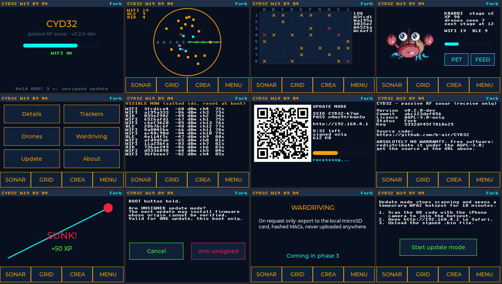

<!-- SPDX-License-Identifier: AGPL-3.0-only -->
<!-- SPDX-FileCopyrightText: 2026 CYD32 contributors -->
# CYD32

Educational, **passive (receive-only)** radio "sonar" firmware. Two board
targets are built from this repository (signed firmware images for both are
published on the `v0.2.0-test1` pre-release and listed in its `SHA256SUMS`):

- `cyd` — ESP32-2432S028 "Cheap Yellow Display" (ILI9341 320x240, XPT2046
  touch, 4 MB flash).
- `m5stack-stopwatch` — M5Stack StopWatch Dev Kit, SKU C152 (ESP32-S3R8,
  16 MB flash, 8 MB OPI PSRAM, 466x466 round CO5300 AMOLED, CST820B touch).

It listens to Wi-Fi management frames and Bluetooth Low Energy advertisements,
draws them on a naval-sonar UI and feeds a small creature that grows as it
meets distinct radio sources. Four creatures (FENNI, LUMO, KRABBI, POULPI)
hatch, idle and react; they grow with unique detections (24 h address dedup)
and take on a Cthulhu form as they meet drones broadcasting Remote ID.
On the StopWatch the v7 sprites are reused and upscaled with an integer
nearest-neighbour blit at 3x (192 px) into a PSRAM buffer.



From `v0.2.0-test3` the boot, sonar and (StopWatch) wardriving screens use the
v9 green phosphor radar theme: a procedural PPI scope with a 3 s clockwise
sweep, a 40 degree trailing wedge and fading echoes; yellow is reserved for
drones (#FCEE0A on both boards). The StopWatch boot screen shows the M5Stack
logo; every other StopWatch screen is phosphor green on black, and the screens
with the 4 tabs (sonar, grid) use the curved tab band. On the CYD the remaining
screens use the same phosphor tokens (README section 7 of the design). The
first screen after boot is the creature (an egg that hatches, then grows with
detections). Reference renders and host renders of the firmware are in
[`docs/screenshots/v9/`](docs/screenshots/v9/) (counters and contacts there are
EXAMPLE DATA; not tested on hardware yet).

## What it does (and does not do)

- Wi-Fi: promiscuous mode filtered to **management frames only** (beacons, probe
  requests/responses). DATA frames are dropped by the driver filter. Frame
  contents are not kept.
- BLE: **passive** scan (no scan requests). The NimBLE central/peripheral/broadcaster
  roles are compiled out, so no GATT connection is possible.
- Never transmits on its own: no `esp_wifi_80211_tx`, no deauth, no spam, no jamming.
  The only radio emission is the temporary update hotspot you start yourself.
- MAC addresses are replaced by `SHA-256(random per-boot salt || MAC)`. The salt
  lives in RAM only, so IDs cannot be linked across reboots.
- **Nothing is stored by default**: no flash or SD logging. On CYD, wardriving
  export (phase 3) will only write to the local microSD card on request, never
  upload. The StopWatch has no microSD slot: wardriving there logs to a fixed
  RAM table of salted IDs (cleared at reboot, oldest dropped when full), never
  to flash, NVS or a network.
- Remote ID (ASTM F3411) beacons over Wi-Fi and BLE are counted as drones.

## Status (phase 2 MVP)

| Feature | State |
|---|---|
| Boot, display, touch, tab bar | done |
| Sonar, grid (+ easter egg A1-B2-C3-D4), details | done |
| Passive Wi-Fi mgmt + BLE scan, hashed IDs | done |
| Creature (4 lineages; sizes at 10/40/120/300 unique detections; Cthulhu at 1/3/6/10/15 drones) | done |
| About screen (licence, version, commit, source) | done |
| Signed OTA from an iPhone, A/B slots, rollback | done |
| Trackers, drones (Remote ID decoding) | phase 3 (stub screens) |
| Wardriving on StopWatch (RAM-only, salted IDs, cap 1024) | done (no GPS / no export; hardware untested) |
| M5Stack StopWatch target (round HUD, dual firmware) | done (v8 round HUD; hardware untested) |

## Hardware notes

CYD, pin map (single-USB ESP32-2432S028): TFT on HSPI (SCK 14, MOSI 13, MISO 12,
CS 15, DC 2, BL 21), touch on its own SPI (SCK 25, MOSI 32, MISO 39, CS 33,
IRQ 36). Touch calibration is in `src/hw.cpp`.

StopWatch (verified against the official M5Stack documentation): ESP32-S3R8,
16 MB flash, 8 MB OPI PSRAM (`qio_opi`). CO5300 QSPI on G39 CS, G40 SCK,
G38 TE, G41/G42/G46/G45 data; display reset on M5IOE1 PYG5. CST820B touch on
G47 SDA, G48 SCL, G13 INT; touch reset on M5IOE1 PYG4. KEYA (yellow) is GPIO2 and is BACK; KEYB (blue) is GPIO1 and is SELECT.
The power button is not mapped (the PMIC handles on/off). There is no microSD.
M5Unified and M5GFX drive the panel, touch and buttons. The native 466x466
round HUD is in `src/ui_round.cpp` (metrics in `include/ui_layout_round.h`).
Approved layout mockups (example data, not device captures) are in
`docs/design/stopwatch-v8/`. The CYD 320x240 layout stays in
`include/ui_layout_cyd.h` and `src/ui.cpp`.

## Build

```bash
pip install --require-hashes -r requirements.txt
pio run -e cyd                      # .pio/build/cyd/firmware.bin
pio run -e m5stack-stopwatch        # .pio/build/m5stack-stopwatch/firmware.bin
```

Versions are pinned in `platformio.ini`. Build-time options (environment
variables): `CYD32_OTA_PUBKEY`, `CYD32_OTA_PUBKEY2` (paths to P-256 public keys,
default `keys/ota_pub_0.pem` and `keys/ota_pub_1.pem`), `CYD32_SOURCE_URL`,
`CYD32_OFFICIAL=1` (upstream releases only).

## First flash (USB, from a computer)

Step-by-step guide for both boards (web flasher, every field, serial console,
troubleshooting): **[docs/INSTALL.md](docs/INSTALL.md)**.

The first install must be done over USB from a computer:

```bash
pio run -e cyd -t upload                       # CYD
pio run -e m5stack-stopwatch -t upload         # StopWatch (bootloader at 0x0)
```

or with esptool and the four release files for the board (bootloader,
partitions, boot_app0, firmware; see `docs/RELEASING.md`). There is no merged
image. The bootloader goes at 0x1000 on the CYD (ESP32) and at 0x0 on the
StopWatch (ESP32-S3); on both, partitions go at 0x8000, boot_app0 at 0xe000 and
the app at 0x10000. Flash settings: CYD `dio` / `40m` / `4MB`, StopWatch
`dio` / `80m` / `16MB` (as in the image headers). Browser
flashers need Web Serial (Chrome or Edge on a computer); iOS has no Web Serial.
USB flashing always remains possible: CYD32 burns **no eFuse**, and uses no
Secure Boot and no flash encryption.

## Updating from an iPhone (OTA)

1. MENU > Update > *Start update mode*. Scanning stops; a WPA2 hotspot with a
   random password starts for 10 minutes and its `WIFI:` QR code is shown.
2. Scan the QR code with the iPhone camera to join the hotspot.
3. Open `http://192.168.4.1` in Safari and upload the **signed** `.bin` from Files.
4. The device streams the file to the inactive slot, verifies the ECDSA P-256
   signature appended to it, and only then switches the boot slot. On any
   failure the update is aborted and the slot is erased.
5. After reboot the new firmware must pass a self-test, otherwise the
   bootloader rolls back to the previous slot.

The portal shows licence, version, commit and source URL; it never exposes scan data.
It only answers requests whose `Host` is `192.168.4.1`, and uploads must carry a
random per-session token embedded in the page (CSRF protection). Uploads larger
than the OTA slot are rejected. A file built for the other board (the image
embeds `CYD32-TARGET:<env>`) is rejected before the boot slot is switched,
with a message on the device and on the portal. If the uploaded firmware is
older than the running one (or carries no version marker), it is not activated
until you confirm the DOWNGRADE on the touchscreen.

### Firmware status: Official / Fork / Unsigned

- **Official**: upstream release build whose key fingerprint matches the
  upstream key in `keys/ota_pub_0.pem`.
- **Fork**: built by anyone else with their own key (`scripts/gen-key.sh`).
  Forks set `CYD32_OTA_PUBKEY` to their own public key.
- **Unsigned**: installed through the one-shot unsigned mode. To arm it, hold
  the board button for 3 s **during the boot splash** (BOOT / GPIO0 on CYD,
  not before reset, which enters the USB bootloader; KEYA / GPIO2 on
  StopWatch), then confirm on the touchscreen. It accepts one unsigned update
  during that boot only and shows a persistent red banner.

The About screen shows the status and the fingerprint of the verifying key
(first 16 hex digits of SHA-256 of the raw public key). Two key slots allow key rotation.

## Known TODOs

- Test on real hardware: Wi-Fi `WIFI_MODE_NULL` + promiscuous capture, BLE/Wi-Fi
  time-slicing, touch calibration, OTA end to end with rollback. The StopWatch
  target has not been run on a device yet (AMOLED colour endianness, circular
  clip, CST820B touch including the r=213 safe circle, KEYA BACK / KEYB SELECT,
  A+B long-press menu, KEYA unsigned-mode gesture, battery reading, creature
  x3 blit, RAM-only wardriving, OTA, scanner).
- Migrate `src/ota_sig.cpp` and `src/privacy.cpp` to the mbedTLS 3 API (the
  `*_ret` SHA-256 functions and direct `grp`/`Q` access go away) before moving to
  arduino-esp32 3.x / ESP-IDF 5.

## Signing and releases

Signing happens **locally** on the maintainer's machine; no private key is
ever stored in GitHub. See [docs/RELEASING.md](docs/RELEASING.md).

## Installation Information (AGPL-3.0 section 6)

The application signature only controls OTA updates; anyone can always
reflash a modified firmware over USB. If Secure Boot is ever enabled on a
device given to someone else, the means to install modified firmware on it
(keys or procedure) must be provided with it.

## Contributing

Install the pre-commit hook: `ln -s ../../hooks/pre-commit .git/hooks/pre-commit`.
It checks staged changes against a private deny-list in
`~/.config/cyd32/denylist.txt` (one fixed string per line) if present.

## Licence

Copyright (C) 2026 CYD32 contributors. AGPL-3.0-only, see `LICENSE` and `NOTICE`.
